# Testes no Thunder Client Atividade 1

## Alterar Cliente (PUT)

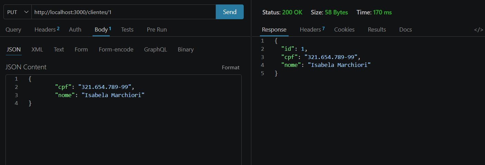

## Excluir Cliente (DELETE)

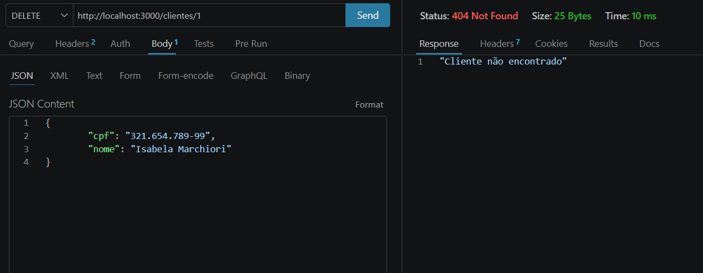

## Alterar Pedido (PUT)

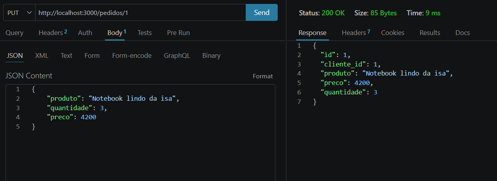

## Excluir Pedido (DELETE)

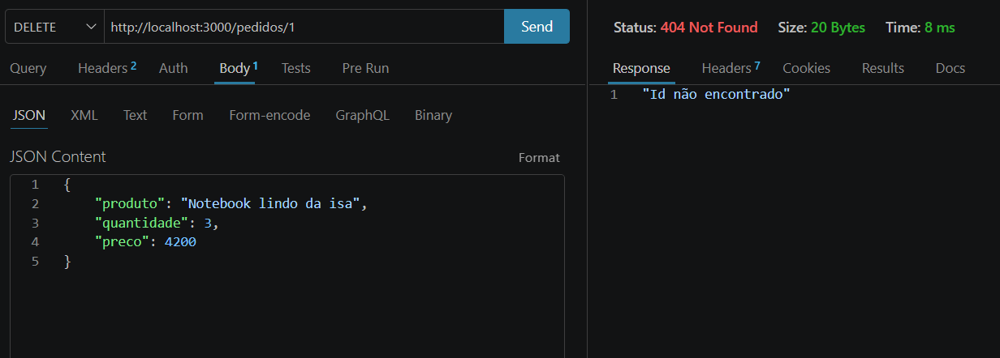

## Produtos Atividade 2

### GET Produtos
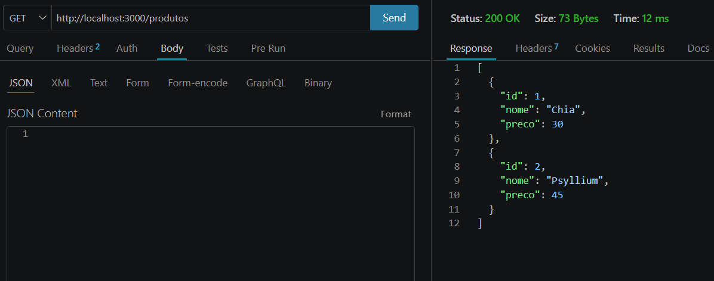

### POST Produto
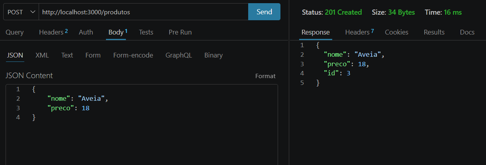

### PUT Produto
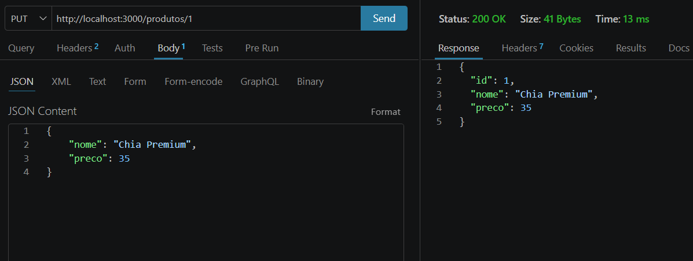

### DELETE Produto
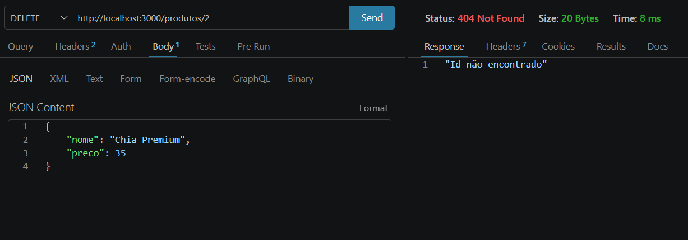

## Itens Atividade 3

### GET Itens
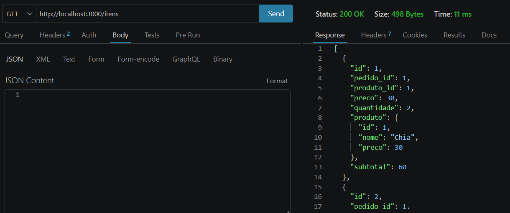

### POST Item
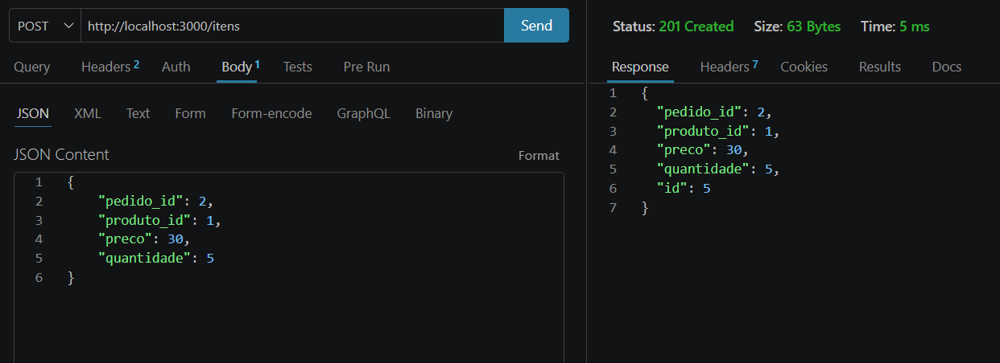

### PUT Item
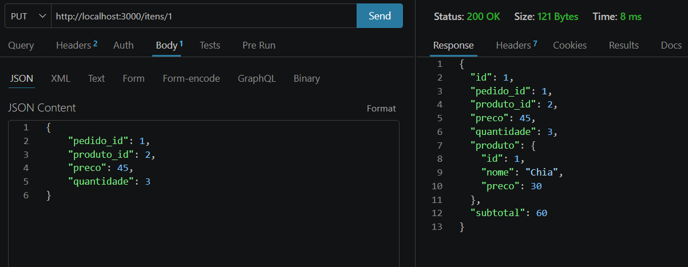

### DELETE Item

## Pedidos Atividade 4/5

### GET Pedidos
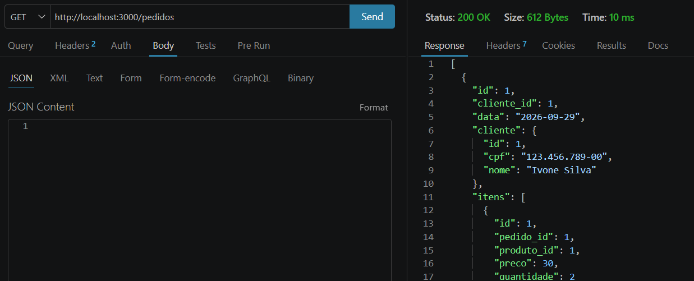